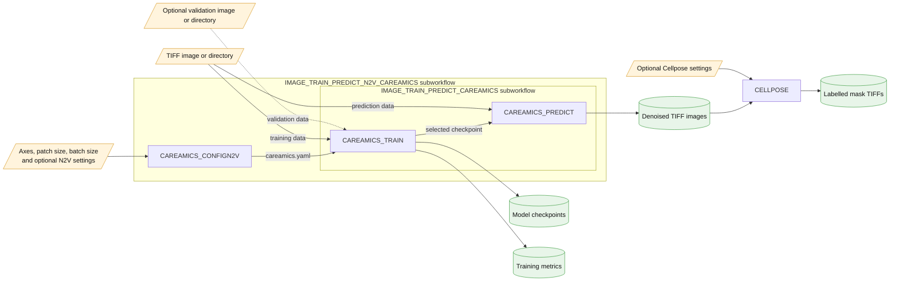

# nobias-fht/denoisesegment

[](https://github.com/codespaces/new/nobias-fht/denoisesegment-nf-demo)
[](https://github.com/nobias-fht/denoisesegment-nf-demo/actions/workflows/nf-test.yml)
[](https://github.com/nobias-fht/denoisesegment-nf-demo/actions/workflows/linting.yml)
[](https://www.nf-test.com)

[](https://www.nextflow.io/)
[](https://github.com/nf-core/tools/releases/tag/4.2.1)
[](https://docs.conda.io/en/latest/)
[](https://www.docker.com/)
[](https://sylabs.io/docs/)
[](https://cloud.seqera.io/launch?pipeline=https://github.com/nobias-fht/denoisesegment-nf-demo)

## Introduction

**nobias-fht/denoisesegment** is an image-analysis pipeline that denoises TIFF microscopy images and then produces instance segmentations of cells. It trains a self-supervised [Noise2Void (N2V)](https://careamics.github.io/) model with CAREamics on the supplied images, applies the trained model to those images, and passes each denoised TIFF to [Cellpose](https://www.cellpose.org/) to generate labelled segmentation masks.



The default analysis steps are:

1. Create an N2V configuration from the required CAREamics parameters.
2. Train CAREamics on the input TIFF data, optionally using separate validation data.
3. Select the checkpoint recorded by CAREamics and use it to denoise the input data.
4. Run Cellpose independently on each denoised image and publish the labelled masks.

The main inputs and outputs are described in more detail in the [usage](docs/usage.md) and [output](docs/output.md) documentation.

## Usage

> [!NOTE]
> If you are new to Nextflow and nf-core, please refer to the [nf-core environment setup documentation](https://nf-co.re/docs/get_started/environment_setup/overview) before running the workflow.

Provide `--input` as either one TIFF file or a directory containing TIFF images. You must also describe the image axes and choose the spatial patch size and batch size used by CAREamics. For example:

```bash
nextflow run nobias-fht/denoisesegment-nf-demo \
   -profile <docker/singularity/.../institute> \
   --input path/to/images \
   --outdir <OUTDIR> \
   --careamics_axes CYX \
   --careamics_patch_size "64 64" \
   --careamics_batch_size 64 \
   --careamics_n_channels 2
```

You can also use the nf-core launcher to more easily select parameters with:

```bash
nf-core pipelines launch nobias-fht/denoisesegment-nf-demo
```

> [!WARNING]
> Please provide pipeline parameters via the CLI or Nextflow `-params-file` option. Custom config files including those provided by the `-c` Nextflow option can be used to provide any configuration _**except for parameters**_; see [docs](https://nf-co.re/docs/running/run-pipelines#using-parameter-files).

## Example data

Example data is available using the download script in [this GitHub gist](https://gist.github.com/melisande-c/bc2d3abe95eb8e66725e03e22e31eec0).

Using `uv`, this can be run directly from GitHub with:

```bash
uv run https://gist.githubusercontent.com/melisande-c/bc2d3abe95eb8e66725e03e22e31eec0/raw/919580897df22b44da6663173dca15ab55b979a8/download_example_jump.py
```

This downloads 10 two-channel images to `./data/example-jump` in the directory from which the script is run. The images have `CYX` axes, so `--careamics_n_channels 2` is required. A patch size of `64 64`, a batch size of `64`, and 20 training epochs are suggested for this small demonstration dataset:

```bash
nextflow run nobias-fht/denoisesegment-nf-demo \
   -profile docker \
   --input ./data/example-jump \
   --outdir ./results \
   --careamics_axes CYX \
   --careamics_n_channels 2 \
   --careamics_patch_size "64 64" \
   --careamics_batch_size 64 \
   --careamics_num_epochs 20
```

See the [usage documentation](docs/usage.md) for parameter-file and GPU-profile examples.

## Credits

nobias-fht/denoisesegment was originally written by Melisande Croft.

## Contributions and Support

If you would like to contribute to this pipeline, please see the [contributing guidelines](docs/CONTRIBUTING.md).

## Citations

To cite this pipeline, use the metadata in [`CITATION.cff`](CITATION.cff). Please also cite the software used in your analysis.

An extensive list of references for the tools used by the pipeline can be found in the [`CITATIONS.md`](CITATIONS.md) file.

This pipeline uses code and infrastructure developed and maintained by the [nf-core](https://nf-co.re) community, reused here under the [MIT license](https://github.com/nf-core/tools/blob/main/LICENSE).

> **The nf-core framework for community-curated bioinformatics pipelines.**
>
> Philip Ewels, Alexander Peltzer, Sven Fillinger, Harshil Patel, Johannes Alneberg, Andreas Wilm, Maxime Ulysse Garcia, Paolo Di Tommaso & Sven Nahnsen.
>
> _Nat Biotechnol._ 2020 Feb 13. doi: [10.1038/s41587-020-0439-x](https://dx.doi.org/10.1038/s41587-020-0439-x).
